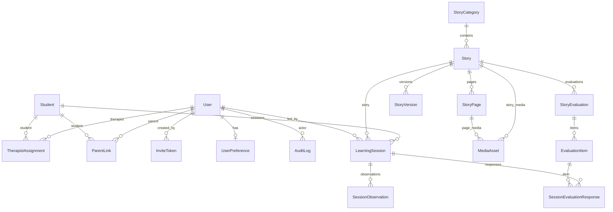

# ERD — CERMIN

| Field    | Value                      |
| -------- | -------------------------- |
| Version  | 0.1                        |
| Date     | 2026-10-15                 |
| Database | PostgreSQL (Supabase)      |
| ORM      | Prisma                     |
| IDs      | UUID (`uuid` / `@db.Uuid`) |

## 1. Diagram (logical)

## 2. Cardinality summary

| Relationship            | Cardinality | Notes                                          |
| ----------------------- | ----------- | ---------------------------------------------- |
| Therapist ↔ Student     | M:N         | `TherapistAssignment` + history via `ended_at` |
| Parent ↔ Student        | M:N         | `ParentLink`                                   |
| Category → Story        | 1:N         | Many stories per category                      |
| Story → Page            | 1:N         | Ordered `sort_order`                           |
| Story/Page → Media      | 1:N         | Files in Storage; DB holds metadata            |
| Story → Evaluation      | 1:N         | Multiple evaluations                           |
| Evaluation → Item       | 1:N         | Multiple items                                 |
| Student+Story → Session | 1:N         | Repeated learning sessions                     |
| Session → Observation   | 1:N         |                                                |
| Session → Eval response | 1:N         | Per item per session                           |

## 3. Entity definitions

### User

| Column                      | Type          | Notes                           |
| --------------------------- | ------------- | ------------------------------- |
| id                          | UUID PK       |                                 |
| email                       | citext/unique |                                 |
| name                        | text          |                                 |
| role                        | enum          | `ADMIN`, `TERAPIS`, `ORANG_TUA` |
| status                      | enum          | `ACTIVE`, `DISABLED`            |
| password_hash / auth tables | —             | Managed by Better Auth schema   |
| created_at / updated_at     | timestamptz   |                                 |

### Student

| Column                  | Type        | Notes                   |
| ----------------------- | ----------- | ----------------------- |
| id                      | UUID PK     |                         |
| display_name            | text        | Required                |
| date_of_birth           | date        | Optional                |
| admin_notes             | text        | Limited; necessary only |
| status                  | enum        | `ACTIVE`, `ARCHIVED`    |
| created_at / updated_at | timestamptz |                         |

### TherapistAssignment

| Column         | Type                                              | Notes                |
| -------------- | ------------------------------------------------- | -------------------- |
| id             | UUID PK                                           |                      |
| therapist_id   | UUID FK → User                                    | role must be TERAPIS |
| student_id     | UUID FK → Student                                 |                      |
| started_at     | timestamptz                                       |                      |
| ended_at       | timestamptz                                       | null = active        |
| assigned_by    | UUID FK → User                                    |                      |
| Unique partial | (therapist_id, student_id) WHERE ended_at IS NULL | One active pair      |

### ParentLink

| Column         | Type                    | Notes                         |
| -------------- | ----------------------- | ----------------------------- |
| id             | UUID PK                 |                               |
| parent_id      | UUID FK → User          | ORANG_TUA                     |
| student_id     | UUID FK → Student       |                               |
| relation_label | text                    | e.g. ayah/ibu/wali — optional |
| is_active      | boolean                 |                               |
| Unique         | (parent_id, student_id) |                               |

### StoryCategory

| Column      | Type    | Notes    |
| ----------- | ------- | -------- |
| id          | UUID PK |          |
| name        | text    |          |
| description | text    | optional |
| sort_order  | int     |          |
| is_active   | boolean |          |

### Story

| Column                  | Type           | Notes                                    |
| ----------------------- | -------------- | ---------------------------------------- |
| id                      | UUID PK        |                                          |
| category_id             | UUID FK        |                                          |
| title                   | text           |                                          |
| description             | text           |                                          |
| learning_objectives     | text           |                                          |
| status                  | enum           | draft/review/approved/published/archived |
| created_by              | UUID FK → User |                                          |
| published_at            | timestamptz    | nullable                                 |
| created_at / updated_at | timestamptz    |                                          |

### StoryVersion

| Column        | Type        | Notes                        |
| ------------- | ----------- | ---------------------------- |
| id            | UUID PK     |                              |
| story_id      | UUID FK     |                              |
| version_no    | int         | monotonic per story          |
| snapshot_json | jsonb       | immutable published snapshot |
| created_by    | UUID FK     |                              |
| created_at    | timestamptz |                              |

### StoryPage

| Column     | Type                   | Notes |
| ---------- | ---------------------- | ----- |
| id         | UUID PK                |       |
| story_id   | UUID FK                |       |
| sort_order | int                    |       |
| body_text  | text                   |       |
| Unique     | (story_id, sort_order) |       |

### MediaAsset

| Column         | Type        | Notes                    |
| -------------- | ----------- | ------------------------ |
| id             | UUID PK     |                          |
| story_id       | UUID FK     | nullable                 |
| page_id        | UUID FK     | nullable                 |
| kind           | enum        | `IMAGE`, `AUDIO`         |
| storage_bucket | text        |                          |
| storage_key    | text        | path in Supabase Storage |
| mime_type      | text        |                          |
| byte_size      | int         |                          |
| alt_text       | text        | required for IMAGE       |
| sort_order     | int         |                          |
| created_by     | UUID FK     |                          |
| created_at     | timestamptz |                          |

Constraint: at least one of `story_id` / `page_id` set. **Never store public URL as source of truth.**

### StoryEvaluation / EvaluationItem

| Entity          | Key fields                                       |
| --------------- | ------------------------------------------------ |
| StoryEvaluation | id, story_id, title, description, sort_order     |
| EvaluationItem  | id, evaluation_id, prompt, item_type, sort_order |

### LearningSession

| Column           | Type        | Notes                         |
| ---------------- | ----------- | ----------------------------- |
| id               | UUID PK     |                               |
| student_id       | UUID FK     |                               |
| story_id         | UUID FK     |                               |
| led_by_user_id   | UUID FK     | adult session owner           |
| started_at       | timestamptz |                               |
| ended_at         | timestamptz | nullable                      |
| story_version_id | UUID FK     | optional link to version used |

### SessionObservation

| Column      | Type           | Notes |
| ----------- | -------------- | ----- |
| id          | UUID PK        |       |
| session_id  | UUID FK        |       |
| recorded_by | UUID FK → User |       |
| note        | text           |       |
| recorded_at | timestamptz    |       |

### SessionEvaluationResponse

| Column             | Type                             | Notes                   |
| ------------------ | -------------------------------- | ----------------------- |
| id                 | UUID PK                          |                         |
| session_id         | UUID FK                          |                         |
| evaluation_item_id | UUID FK                          |                         |
| value              | text/jsonb                       | flexible for item types |
| note               | text                             | optional                |
| Unique             | (session_id, evaluation_item_id) |                         |

### InviteToken / UserPreference / AuditLog

- **InviteToken:** email, role, token_hash, expires_at, used_at, created_by
- **UserPreference:** user_id, text_size (`SM`|`MD`|`LG`|`XL`), audio_enabled bool, extras jsonb
- **AuditLog:** actor_id, action, entity_type, entity_id, metadata jsonb, created_at

## 4. Indexes (minimum)

- `TherapistAssignment (student_id)`, `(therapist_id)`, partial unique active
- `ParentLink (student_id)`, `(parent_id)`
- `Story (category_id, status)`
- `StoryPage (story_id, sort_order)`
- `LearningSession (student_id, started_at DESC)`, `(story_id)`
- `MediaAsset (page_id)`, `(story_id)`
- `AuditLog (created_at DESC)`, `(entity_type, entity_id)`

## 5. Media storage mapping

| DB                       | Storage                                                                         |
| ------------------------ | ------------------------------------------------------------------------------- |
| `MediaAsset.storage_key` | Object path in private bucket `cermin-media`                                    |
| Access                   | Server checks authz → create signed URL (short TTL) or stream via Route Handler |

## 6. Seed data

- Categories: **Bergiliran**, **Menerima Kemenangan dan Kekalahan**
- Bootstrap Admin user (env-based seed in setup)

## 7. Out of schema (intentionally)

- No `ChildUser` / Murid role table (guided mode only)
- No `Organization` / tenant table (single lembaga)
